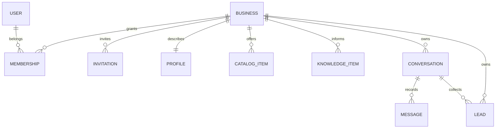
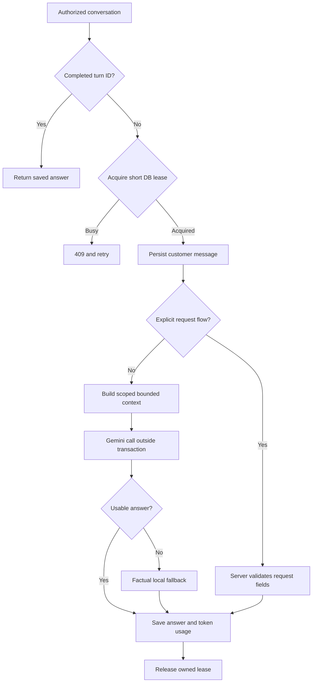

# NEXORA — инженерный аудит и повторная проверка

# Повторная инженерная проверка NEXORA

Основной результат: существующий проект сохранён; проверенный кандидат дополнен защитой восстановления серверных заявок и общими лимитами Gemini. Финальный набор — **116 успешных тестов**.

## Новые исправления

B24: Lead и Message.request_response изменяются в одной короткой транзакции. Сбой последующего сохранения ответа не превращает повтор исходной заявки в имя клиента и не теряет ответ о завершении. Добавлена миграция 0005; rollback и stale-worker fence проверены.

B25: NEXORA_AI_BUSINESS_PER_DAY и NEXORA_AI_GLOBAL_PER_DAY ограничивают попытки Gemini одновременно в публичном чате и Playground. Неуспешная попытка тоже расходует лимит; завершённый replay не вызывает провайдера. Фиксированные окна — сутки UTC. Это не бюджет в тенге и не биллинг.

B26: локальный тест SDK учитывает оба HTTP-клиента, чтобы SOCKS-прокси окружения не мешал тесту на localhost. Proxy настройки приложения не менялись.

## Отчёты и ограничения

В docs находятся все 14 требуемых направлений: общий вывод, архитектура, подтверждённые ошибки, AI, конкуренты, UX, хакатон, портфолио, стратегия, roadmap, проверки, изменения и следующие задачи; обновлённые исходники — в корне архива. NEXORA-AUDIT.md объединяет текстовые отчёты.

Ключ Gemini и реальная база отсутствуют. Нет доказанного качества живой модели, готовых уведомлений владельцу, полноценного human handoff или production-сертификации. 60 минут работы в текущем проходе не выполнены; подробная временная граница — AUDIT_SCOPE.md.


---

# Границы проверки и время

Текущий проход: с 2026-10-09 06:10 UTC до 2026-10-09T06:22:32.543761+00:00, около 12.4 минут календарного времени. Требование минимум 60 минут в текущем проходе **не выполнено**. Час активной работы не заявляется; искусственного ожидания не было.

В рабочей папке был обнаружен ранее подготовленный NEXORA-UPDATED.zip с исправлениями и отчётами. Он использован как кандидат, затем независимо сверён с повторно загруженным архивом, прогнан через проверки и дополнен исправлениями B24–B26. Исторические логи не выдаются за результаты текущего прохода: актуальные доказательства имеют префикс REVERIFY. Предыдущий отчёт описывал примерно 31 минуту отдельной работы; это не час непрерывной работы и не причина прибавлять время задним числом.

Нет настоящей клиентской базы, ключа Gemini или полных исходников исторических релизов. Tagam и другие компании в стендах — синтетические. Реальный Gemini не вызывался: evaluate_ai --live завершился до запросов с missing-key. История из задания использована как контекст, не как доказательство текущего кода. Внешние системы не изменялись, публикации не было.


---

# NEXORA AI — итог аудита

NEXORA — работающий прототип универсального консультанта для компаний. Уже есть реальная цепочка приглашение → владелец → данные компании → публичный чат → заявка → CRM. Это полезнее демонстрационного окна с LLM, но пока недостаточно для самостоятельной коммерческой эксплуатации.

## Что доказано

Исходный проект сохранён. Проверены доступы владельца и сотрудника, межфирменная изоляция HTTP-эндпоинтов и контекста, CSRF, приглашения, каталог, CRM, повторы сообщений, исключения SDK, миграции и мобильный интерфейс. У исходного архива на Django 6.0.9 было 51 тест, из них 2 падали. Причина этих двух падений — устаревшее ожидание имени источника fallback, а не утечка данных.

Повторная проверка 9 октября: 116 тестов, все прошли. См. REVERIFY-FINAL-TEST.log. Добавлены шесть проверок восстановления заявки и общих лимитов Gemini.

Исправлены подтверждённые ошибки: повторный вход обычного владельца, CRM-поиск после slice, некорректные идентификаторы, повторные сообщения, гонка приглашений и подтверждений, неправильные метрики, потеря релевантных фактов за первыми позициями каталога, вопросы во время сбора заявки и мобильное переполнение. Общий сервис обработки сообщений защищает публичный чат и Playground. Модель вызывается вне транзакции базы. Добавлены ограничение частоты, контекст с бюджетом, редактирование контактов клиента, учёт токенов и безопасные логи.

При реальной параллельной работе с отдельным файлом SQLite исходная конфигурация дала 68 ошибок 503 из 80 запросов. После режима IMMEDIATE и коротких транзакций получены 80 ответов HTTP 200, 80 диалогов и 160 сообщений. Это проверка локального приложения без сетевого LLM, а не производственная нагрузочная сертификация.

## Что остаётся недоказанным

Ключ Gemini не предоставлен. Живая модель не вызывалась; естественность, русско-казахские ответы, галлюцинации и устойчивость к prompt injection требуют отдельного набора живых оценок. Проверен настоящий SDK на синтетическом локальном HTTP-транспорте, что подтверждает формат запроса, тайм-аут и обработку ошибок, но не качество модели.

Сбор заявки всё ещё использует детерминированный универсальный сценарий. Свободная форма, несколько товаров и сложные изменения заказа не реализованы полностью. Передача оператору и уведомления владельца не подтверждены. Каналы Telegram/WhatsApp/Instagram в модели данных не означают наличие интеграций. Публикации во внешнюю среду не было.

## Оценка и решение

Новизна идеи — 3/10: рынок развит. Польза — 7/10 при доказанной экономии времени. Техника прототипа — 6/10, AI — 5/10, масштабирование — 4/10. Для портфолио сильнее всего показать проверенную изоляцию, повторяемые тесты, миграции и объяснить ограничения собственными словами. Нельзя заявлять production-ready, платящих клиентов или измеренный ROI.

Следующий этап — живой набор из 30–50 сценариев и небольшой пилот с 2–3 компаниями. Измерять долю подтверждённых фактов, ошибочные заявки, время владельца и полезные обращения. Цена и готовность платить — гипотезы до интервью и реального платежа. Подробности, источники, сценарий демонстрации и roadmap находятся в остальных отчётах.


---

# Architecture audit

Scope: the provided NEXORA-WORK-FULL archive. No production database, deployment or provider key was included. The version names describe history, not separate verified code snapshots.

## Current boundaries

| Module | Responsibility | Data / important entry points | Assessment |
|---|---|---|---|
| core | Tenant membership, invitation onboarding, dashboards, connection links | Business, Membership, BusinessInvitation; launch_views, connect_views | Sensible MVP separation. Duplicate membership selectors consolidated. Business login was missing. |
| business_brain | Structured company facts | BusinessProfile, CatalogItem; forms, knowledge | Appropriate source of company prices and availability. Price/duration validation strengthened. |
| assistant_ai | Dialogue persistence, knowledge, Gemini, request collection | Conversation, Message, KnowledgeItem, Lead; universal_engine, lead_engine | Central engine is shared. Transport/context/state are now separate files. Request extraction still constrained. |
| public_chat | Anonymous customers | Session-bound conversation; chat_page/chat_send | Client cannot choose the tenant or conversation. No-store headers and bounded usage added. |
| business_center | Owner workspace / CRM | Knowledge editing, request search and status transitions | Search after slicing was broken. Confirmation logic unified. Not a complete CRM. |
| config | Environment, routing, middleware | settings, urls, test_runner | .env loading preserved; explicit production HTTPS mode and offline tests added. |

## Data model



Business foreign keys enforce ownership in application queries. They do not automatically create PostgreSQL row-level security. `Lead.business` duplicates `Conversation.business`; a model validation now rejects disagreement when `clean/full_clean` is used. Direct SQL and arbitrary ORM writes still bypass that validation; the server collection path sets the business from the conversation.

A platform operator's `User.is_staff` and a company `Membership.role='staff'` are different concepts. Ordinary owners do not get Django admin access. Platform administrators with model permissions intentionally have broader administrative access; this is not tenant-scoped business UI.

## Turn lifecycle after the update



`processing_token` and `processing_until` implement an expiring single-worker lease. The maximum Gemini timeout is shorter than the lease. A late worker cannot commit its answer or clear a newer lease. A timeout or crash leaves the customer's persisted message available for recovery. This is not a distributed job queue or exactly-once provider billing: a crashed worker can have incurred an API charge before a retry.

The frontend sends a UUID `turn_id`; a uniqueness constraint on conversation/role/turn prevents duplicate persisted replies. Completed replays reuse the saved answer. Public conversations have a unique business/session digest. Playground first turns have a unique business/customer/initial-turn identifier.

## Operations and scaling

SQLite is appropriate for local demonstration. Removing network calls from write transactions helps, but it does not make SQLite suitable for 100 busy companies. Quota rows and status transitions remain write contention points. Move to PostgreSQL with a tested migration, configure backup/restore, then benchmark real concurrent traffic. Add Redis/edge limits only when shared DB counters become a measured bottleneck.

The current engine uses synchronous Django workers. Each genuine Gemini call still occupies one worker up to its timeout. Streaming, task queues and WebSockets can improve experience later; they are not prerequisites for a measured small pilot.

The Sales Radar eagerly loads all conversations/messages: this remains a scalability cost. The conversation list now uses an annotated first-message subquery; a regression test checks that query count does not grow with dialogue count. Public history is now the newest 150 messages, while the stored history is kept. Public conversations are limited to 100 customer turns.

## Migration / portability

Original migrations declare BigAutoField primary keys; DEFAULT_AUTO_FIELD now matches them. The original catalog index name is explicit, avoiding a spurious index migration. Three additive assistant_ai migrations introduce leases, turn IDs, quota buckets and an atomic request-action receipt. No data rewrite or database file is shipped. Requirements are UTF-8 and now include the previously missing Gemini SDK and QR generator. Django 6.0.9 package metadata requires Python >=3.12; verification uses Python 3.13.16.

Full schema/data preservation checks are in TEST_RESULTS.md. Existing legacy public dialogues are recovered by their original session ownership; new ones use a digest constraint.

## Recovery hardening, 9 October

Message.request_response is a server-only receipt. A short transaction commits the Lead transition and this receipt together. If saving the final assistant Message fails, retrying the same turn returns the recorded request response without advancing collection. A processing-token fence prevents a stale worker from applying the action. Gemini requests in both channels share per-business and platform daily attempt budgets; completed replays and deterministic request collection incur no provider attempt. Attempts are not a money-denominated budget, and a provider-success/worker-crash can still be billed twice on retry.


---

# Confirmed bugs and security findings

Severity describes the risk of the observed code path. “Fixed” means changed and regression-tested at application level. It is not a penetration-test certification. No cross-company leak was found in the tested authorized business UI paths.

| ID / priority | File and function in original archive | Cause / reproduction | Consequence | Change / verification |
|---|---|---|---|---|
| B01 P0 High — fixed | config/settings.py LOGIN_URL; default admin login | Register an ordinary invited owner; log out; follow protected page's login redirect. Admin authentication rejects nonstaff. | Owner cannot resume work. | `/accounts/login/`, CSRF-protected logout, login attempt quota; nonstaff owner login/logout/open-redirect tests. |
| B02 P1 High — fixed | public_chat/views.py chat_send; assistant_ai/views.py send_message | `respond()` runs inside `transaction.atomic()` after a message insert. Gemini may take seconds. | Long SQLite writer transaction blocks unrelated business writes; failures can roll back the question. | Shared turn service persists question and calls Gemini outside a write transaction; TransactionTestCase asserts network responder is outside atomic. |
| B03 P1 High — improved | public_chat/views.py cache get/set limit | Use new sessions; requests across processes; concurrent get/set read the same count. | Public traffic can exceed intended API cost/abuse cap. | Durable atomic fixed-window counters for session, direct peer IP, business/day and platform/day. Cookie reset, forged X-Forwarded-For and multiple-IP tests. Edge abuse protection remains necessary. |
| B04 P1 High — fixed for completed replays | Both chat send views | Submit the same message again after a lost response; send two turns simultaneously. No turn identity/lease. | Duplicate questions, replies or collection transitions; interleaved memory. | Turn UUID and uniqueness, lease, replay, lease-expiry and stale-worker tests. Crash-before-persist provider rebilling remains possible. |
| B05 P1 Medium — fixed | business_center/views.py studio | Query `?q=Арман`: queryset was sliced before `.filter()`. | Django TypeError / search page outage. | Filter first, slice last; owner search and foreign-data exclusion test. |
| B06 P1 Medium — fixed | assistant_ai/universal_engine.py respond | REQUEST_WORDS matches “доставка” or “брони…” even in an information question. It also differs from lead_engine's intent matcher. | User is forced into a request form or `None` can be returned as answer. | One explicit request predicate; delivery / booking-policy / callback tests; Gemini handles general questions. |
| B07 P1 Medium — fixed | lead_engine cancellation vs unused universal_engine CANCEL_WORDS | During collection send “отмена заказа” / “отменить бронь”. The advertised cancellation variants aren't accepted by `is_cancel`. | Cancellation can be stored as a customer name or invalid field. | Unified cancellation variants; tests for Russian and Kazakh variants. |
| B08 P1 Medium — fixed | core/views.py lead_status; business_center/views.py booking_action | Complete a request with “без времени”, then confirm it. Both views reject absent timestamp. | Valid purchases/callbacks cannot move forward. | Shared transition service permits untimed requests; keeps past/conflicting timed requests blocked; tests cover both CRM endpoints. |
| B09 P1 High — improved | Same two CRM functions | Two new leads for overlapping times; confirm concurrently. One endpoint has no transaction and the other only locks its lead. | Both may be confirmed despite the cross-lead conflict rule. | Short business-wide write lock before validation; SQLite write serializes and PostgreSQL row update serializes. Unit rejection tests and concurrency checks; resource-aware scheduling remains missing. |
| B10 P1 Medium — fixed | business_brain/forms.py CatalogForm | POST price=-1 or duration_minutes=0. HTML min values are not server validation. | Invalid company facts become AI context. | Server validation, negative-price/zero-duration tests. |
| B11 P1 Medium — fixed | Tenant selectors and item edit views | Query `business=broken` or edit with `item_id=broken`. Integer FK coercion raises rather than returns an HTTP error. | 500 on malformed user input. | Shared selector validation and bounded ASCII numeric IDs; 404/400 tests. |
| B12 P1 Medium — fixed | public_chat/views.py chat_page | Create >150 messages; reload page. Original query shows oldest 150. | Recent context disappears from the customer's display. | Fetch newest then reverse to chronological order; recent-message test. |
| B13 P1 Medium — fixed | universal_engine._safe_llm_answer; send views | Inspect saved assistant Message: `tokens_used=0` always. No provider timeout/retry budget is configured. | Cost visibility is fictitious; worker occupancy is unbounded by app settings. | SDK timeout, one attempt, usage_metadata captured and saved, safe latency/token logging; mocked SDK test. No live billing proof. |
| B14 P1 Medium — improved | universal_engine prompt | System policy, facts and history were one flat text payload; previous assistant guesses looked like evidence. | Injection and hallucination risk; role/memory ambiguity. | Separate system_instruction, JSON data, proper roles, company-only context and explicit unknowns. No database tools exposed. This reduces risk; it does not prove model resistance. |
| B15 P2 Medium — fixed | core/views.py dashboard | Multiple leads per conversation and Playground leads can make “conversion” >100%. Every fallback is counted as an AI reply. | Misleading owner analytics. | Unique real conversations with new/confirmed leads; Playground excluded; Gemini-only reply count; conversion regression test. |
| B16 P1 Medium — fixed | requirements.txt / INSTALL files | Fresh install lacks `google-genai` and `qrcode`; old instructions claim incremental four-file updates. | QR import and real Gemini fail after installing listed requirements. | Explicit SDK/QR dependencies, UTF-8 requirements, full update instructions and included migrations. |
| B17 P1 Medium — improved | response caching / provider error logs | Chat and sensitive authenticated HTML lack explicit no-store; exception traceback may include provider details. | Risk when a reverse proxy caches pages; prompts/secrets may enter logs. | Public never_cache, private authenticated/invitation cache middleware, provider errors logged by type only. Header/log tests. |
| B18 P1 Medium — fixed | core/launch_views.py accept_invite | Password validation is called without the prospective username/email; invitation uses a select-only lock on SQLite. | Similarity validation is skipped; invitation acceptance has weaker concurrency semantics. | Validate against candidate user; hash before DB write; conditional one-use claim with rollback for duplicate username. Existing one-use onboarding test retained. |
| B19 P1 Medium — improved | universal_engine catalog/profile truncation | Only first 30 alphabetic catalog items and first 80 knowledge records are included. | Relevant products disappear while AI sees an apparently complete context. | Tenant-scoped lexical SQL candidate retrieval, relevance sorting, shared character budget, truncation flag. Recent dialogue supports follow-ups. Not semantic/vector retrieval. |

## Remaining verified limitations

- SQLite / synchronous workers are not load-proven for 100 companies. Database counters limit attempts, not currency spend or fair capacity between clients. Configuration defaults are pilot safeguards, not pricing policy.
- The current 60-minute conflict window applies to all timed requests for one business. It lacks staff/resource capacity, item-specific durations and timezone per company. Two restaurant orders can unnecessarily conflict. Keep manual confirmation and build a separate scheduling model before promising real booking.
- Request collection is a deterministic multi-step flow. Questions with question marks or common question prefixes can leave collection temporarily, but unrestricted topic changes, corrections and fully free-form slot extraction are not implemented. English request triggers are incomplete. Gemini does not currently produce a validated structured action proposal.
- A `human` status exists; there is no complete employee inbox with takeover, assignment, notification and return-to-AI. Do not promise human handoff based on the enum alone.
- The widget uses an iframe and default SameSite cookies. Cross-site browser privacy controls can break session/CSRF. Direct links work and are offered; third-party embedding is not certified across browsers. Do not globally weaken cookies as a quick fix.
- Invitation email is assigned to the bearer-token registrant but not verified by email. Anyone holding the one-use link can accept it. Token expiry/hash storage help; secure delivery and verified email remain operational work.
- No password-reset email flow, verified sending service, billing, contractual budgets, customer consent/retention/deletion policy or backup/restore automation is implemented.
- Model `clean()` is not a cross-table DB constraint and not automatic for arbitrary `.save()`/bulk SQL. Maintain tenant checks on every new mutation path; add database-level enforcement if direct data writers expand.
- No original client data was supplied. The prior Tagam conversation's actual profile facts cannot be reconstructed. It is impossible to determine which specific earlier model statements were hallucinated from this archive alone.

## Production settings

Basic HTTPS settings are opt-in through NEXORA_PRODUCTION. `check --deploy` warns about HSTS subdomain/preload options because enabling them requires control over the full domain. The final check used a sufficiently long synthetic key and reports only the two deliberate HSTS warnings; use a fresh private random deployment key. Do not silence the warnings or set proxy headers without validating the reverse proxy. Baseline security guidance: [Django checklist](https://docs.djangoproject.com/en/6.0/howto/deployment/checklist/) and [OWASP LLM injection guidance](https://cheatsheetseries.owasp.org/cheatsheets/LLM_Prompt_Injection_Prevention_Cheat_Sheet.html).

## Additional verified findings

- **B20 P1 High — SQLite contention:** 8 concurrent workers/80 requests reproduced 68 HTTP 503 failures with deferred write transactions. Short IMMEDIATE transactions and a 10-second connection timeout eliminated them in the same local scenario; portable rerun also returned 80/80 successful pairs. This is bounded local evidence, not multi-host capacity proof.
- **B21 P1 Medium — Playground malformed turn ID:** UUID parsing failed before a conversation existed; the exception response referenced an unbound variable. Initialize the optional conversation before parsing and return 400 with null conversation_id. Added regression.
- **B22 P1 Medium — lost first Playground response:** retries without a conversation_id created separate chats and could repeat provider work. Unique initial turn keys recover the same chat; completed replay precedes quota consumption. Added test proving one provider call/two messages.
- **B23 P2 Medium — mobile/catalog navigation:** wide catalog layout overflowed a 390px viewport, and the owner workspace lacked a direct catalog/profile entry. Responsive cards/navigation and a company-data action fix the verified paths. Screenshots and browser checks are included.

## Revalidation findings

| ID | Severity / location | Reproduction and consequence | Fix / evidence |
|---|---|---|---|
| B24 | P1 High, universal_engine.respond / turns.process_turn | Fail the assistant-message insert after creating a request or accepting a name. Retry the same turn: the initial text became the customer name, the wrong next question was returned, or a finalized request lost its confirmation reply. Four tests initially failed. | Atomically record the request response with the Lead transition; fence stale workers. Creation/name/finalization/rollback/stale-worker regressions pass. REVERIFY-RECOVERY-BEFORE.log and REVERIFY-FINAL-TEST.log. |
| B25 | P1 High, _safe_llm_answer | Playground was capped per minute but lacked a daily tenant/platform AI budget; changing conversations bypassed any public-only daily cap. Mock provider factory was called beyond the intended budget. | Shared Gemini attempt counters across channels, with configurable tenant and global limits. Test proves only two provider constructions across three companies under a two-attempt global budget. |
| B26 | P2 Medium, scripts/qa_sdk_transport.py | A SOCKS proxy environment caused SDK client construction to fail before the localhost request. The existing empty SDK evidence file was insufficient. | Disable environment proxies in both SDK test-client configurations; four synthetic transport cases pass with exactly one HTTP attempt each. Application proxy behavior is preserved. |

The failed storage cases are fault-injection tests, not a claim that a real customer experienced these failures. No new tenant leak was found.


---

# AI quality and reliability

## What the code proves

Public chat and owner Playground call the same universal `respond` engine. For normal company/catalog/general questions, Gemini is attempted first when enabled and a key is configured. The request collector writes the Lead record on the server. Gemini has no database tools, no payment execution and no booking-confirmation authority.

The original archive already routes public chat to the universal engine. The historical Chat Fix/Gemini First issue is therefore not reintroduced as a new fix. The two baseline failed tests expected the old “catalog” source label even though the code correctly labels degraded catalog replies “catalog_fallback”; expectations now reflect that distinction.

## Updated context pipeline

1. Resolve an authorized Conversation, deriving its Business server-side.
2. Read profile/catalog/knowledge only for that business. Skip inactive knowledge.
3. Select lexical matches across title/description/content, include bounded baseline candidates, rank with current question plus four recent messages.
4. Reserve context for profile, catalog, knowledge and recent dialogue; mark partial catalog/knowledge coverage explicitly.
5. Preserve the last 24 message roles in chronological order, remove the latest customer question from history so it is sent once, and omit system/human messages from model history.
6. Hide known Lead names, customer-format phones and email addresses from history/latest input. Company phone remains an intentional public company fact.
7. Send system policy separately from JSON company data and typed message history.
8. Use a configurable bounded timeout, one SDK attempt, lower temperature, capped output, safe error logging and actual usage_metadata token totals.

The budget is measured in characters. It is an input bound, not an exact model-token guarantee. Actual token totals come from the provider. Names not known to a Lead and arbitrary sensitive text can remain in free-form messages: this is limited redaction, not complete anonymization or a DLP system.

## Memory

There is persistent conversation history plus bounded recent context. This supports a short follow-up such as “А доставка?” because the previous turns are sent. It is not unlimited long-term personal memory, semantic summarization, cross-channel identity or permanent preference recall. Old details beyond the recent window can be forgotten. Synthetic tests verify history ordering, roles, duplicate removal, privacy and persistence; without a key they cannot verify whether Gemini actually resolves pronouns correctly.

A lease serializes conversation updates. A repeat turn reuses the stored answer. Failed unexpected processing preserves the question and releases the lease; retry can recover. This is stronger than holding the whole request in one DB transaction but does not guarantee exactly-once billing after a provider response and worker crash.

## Factuality

The provider receives structured prices, availability, duration, company hours and rules. Empty fields remain empty. The instructions explicitly require an honest unknown, distinguish general advice from company policy and forbid invented confirmation. Partial context is identified so missing retrieved records are not mistaken for unavailable products.

This is a grounding design, not a demonstrated hallucination rate. There is no semantic output verifier, no source citations in final answers, and no structured fact assertion check. A malicious owner can put false data in the company's own knowledge; the server cannot establish truth about the real world. Previous assistant messages are explicitly not an authoritative source, but the model still sees them for dialogue continuity.

The restaurant Tagam, shop and salon fixtures validate independent business data boundaries and server behavior. They do not reproduce the real Tagam customer experiment, whose database/transcripts were not supplied. Any claim about the original answers on delivery/payment/hours would be speculation.

## Prompt injection

System instructions, role-aware messages and JSON data make boundaries clearer. Tenant scoping and the absence of write tools form the enforceable boundary: even an injected answer cannot execute an order or read another company's rows through an exposed tool. The mock injection test proves payload placement and that no Lead is created by the sample model-text request. It does not prove that a real model obeys the policy. Lower temperature also does not eliminate injection.

Use an adversarial live corpus for data-driven, multi-turn and encoded attacks. Observe unsupported assertions, false confirmations, source disclosure and inappropriate contact requests. Do not use a naive banned-word regex as the main safety guarantee. See [OWASP](https://cheatsheetseries.owasp.org/cheatsheets/LLM_Prompt_Injection_Prevention_Cheat_Sheet.html).

## RAG decision

Do not add a vector database now. This archive contains small structured catalog/profile/knowledge sources and no file ingestion pipeline. Scoped SQL lexical candidate retrieval with a bounded context is a simpler first retrieval layer. It improves on blindly taking the first records. Synonyms, morphology and broad recommendations remain its weak points.

Add full-text or embeddings only after an evaluation set demonstrates unacceptable relevant-document recall at realistic catalog volume. Preserve business filters during retrieval, keep facts structured, record retrieved source IDs, and compare recall/latency/cost before adopting a new service. A vector store alone does not solve memory, permissions, factuality or actions.

## Free-form requests

The collector remains deterministic to keep writes predictable. Explicit request phrases enter it; information questions and short diversions can go to Gemini. It still lacks robust correction (“нет, другое имя”), topic exit, arbitrary multi-field messages and unrestricted language coverage. This is the largest remaining AI-product limitation.

Next iteration: Gemini returns a schema-validated proposal `{intent, fields, missing_fields}`. The server validates allowed fields, tenant, phone, timestamp, length and current state, then requests explicit customer confirmation before persisting a completed request. The proposal must never include an authoritative business ID or executable API instruction. Establish tests before enabling this path. Do not sell the present deterministic collector as a full agent.

## Live evaluation status

No GEMINI_API_KEY exists in the attachment or environment. `evaluate_ai --live` was run and stopped before any provider request with a missing-key error. SDK payload, errors and timeout were also checked using the real SDK against a local synthetic HTTP server. No real Gemini request was made. Real Gemini factuality, language fluency, follow-up reasoning, latency and quota errors remain unverified.

For a later bounded check, use a separate empty SQLite file, migrate it and run:

```powershell
$env:NEXORA_DATABASE_PATH = "$PWD\nexora-ai-eval.sqlite3"
python manage.py migrate
python manage.py evaluate_ai --live --max-calls 6
Remove-Item Env:NEXORA_DATABASE_PATH
```

Keep the real key in your existing local .env; do not paste it into chat. The command refuses the main db.sqlite3, creates synthetic company/catalog fixtures, allows no more than six one-attempt calls, prints answers/token totals for human review and deletes its synthetic business records. It is opt-in and is not part of routine tests.

References: [Google system instructions](https://ai.google.dev/gemini-api/docs/generate-content/text-generation), [SDK timeouts](https://ai.google.dev/gemini-api/docs/generate-content/flex-inference), [token usage](https://ai.google.dev/gemini-api/docs/tokens).

## Recovery and cost guard added in revalidation

Request transitions now persist an atomic response receipt before the final reply write. Creation, name collection and finalization replay correctly after a synthetic failure. Gemini attempt budgets cover public and staff conversations together. Counters include failed attempts, use fixed UTC-day windows, and permit a zero budget; they do not calculate currency spend. Full human evaluations remain required.


---

# Competitor research — checked 2026-10-09 (Asia/Qyzylorda)

Primary vendor pages and documentation were reviewed. User reports are marked as anecdotal and do not establish general failure rates. Plans, billing cycles, quotas and taxes differ; the table is not a like-for-like total-cost estimate. NEXORA's capability column reflects this archive plus the audited changes, not future promises.

| Product / sources | Confirmed capability and price evidence | Strong point / practical limit | NEXORA today / missing | Adopt / avoid |
|---|---|---|---|---|
| [Intercom Fin pricing](https://www.intercom.com/pricing), [preview](https://www.intercom.com/help/en/articles/12599471-use-fin-previews), [batch testing](https://www.intercom.com/help/en/articles/10521711-batch-test-fin-ai-agent) | Fin is advertised from $0.99 per outcome. Preview tests configured content, guidance and audience. Batch tests inspect source coverage without performing production writes. | Mature operational testing. Outcome definitions require care when forecasting cost. | Company data, preview-like Playground and requests exist; no source trace, batch evaluation UI, mature support inbox or resolution measurement. | Adopt safe preview, reproducible eval set and source-gap review; avoid charging for vaguely defined “AI solved” events. |
| [Zendesk AI agents](https://support.zendesk.com/hc/en-us/articles/6970583409690-About-AI-agents), [pricing](https://www.zendesk.com/pricing/), [resolution tiers](https://support.zendesk.com/hc/en-us/articles/9570369117338-About-automated-resolution-tiers) | AI usage measured through automated resolutions. The current suite comparison lists additional committed resolutions at $1.50 and pay-as-you-go at $2.00; included allowances and suite charges depend on plan. These are add-on unit prices, not the complete AI-agent bill. | Established support workflow and broader ticketing ecosystem; billing model and configuration add adoption complexity. | Basic Lead statuses and owner workspace; no genuine ticket assignment, employee takeover or integrations. | Adopt explicit handoff ownership and usage controls; avoid duplicating an enterprise helpdesk before a small-business pilot. |
| [Tidio pricing](https://www.tidio.com/pricing/), [Lyro limits](https://help.tidio.com/hc/en-us/articles/13924459295900-The-Lyro-AI-agent-limit) | Current pricing page shows Lyro from $32.50/mo for 50 AI conversations with annual billing display. New projects receive 50 one-off conversations; paid quota refreshes monthly. | Quick chat deployment and human handoff; a “conversation” has a defined thread rule rather than equalling each response. | Link/QR/widget, company data and Lead collector exist; no notifications, support inbox or safe content import. | Adopt short onboarding and clear quota definition; avoid suggesting a one-off free allotment is a permanent monthly allowance. |
| [Chatbase pricing](https://www.chatbase.co/pricing), [agent playbook](https://www.chatbase.co/blog/the-ai-agent-playbook), [integrations](https://www.chatbase.co/integrations) | Monthly Hobby $40 / 700 credits; Standard $150 / 4,000; Pro $500 / 15,000. Standard lists API access, voice/telephony and auto-resync. Sources/actions/integrations are part of the product. | Fast knowledge-based agent creation; credits, branding and integration requirements affect cost. | Manual knowledge/catalog and one embedded chat; no website/file ingestion, verified API actions or external channels. | Adopt source management and a constrained action boundary; avoid automatic outbound actions without server authorization. |
| [Botpress pricing](https://botpress.com/pricing/), [May 2026 change](https://botpress.com/en/blog/pricing-update-may-2026), [knowledge docs](https://botpress.com/docs/studio/knowledge-base/introduction/), [handoff docs](https://botpress.com/docs/studio/get-started/manage-your-agent/human-handoff/) | Current annual pricing display: Free 100 conversations; Plus $150/mo / 250 conversations; Team $750/mo / 1,500. May 2026 update bundles AI allowance and changes billing from messages to conversations. | Flexible agent tooling and handoff. Older documentation describing separately billed AI Spend conflicts with the pricing update; use current pricing for estimates. | One business-neutral engine and server collector; no visual playbooks, agent runtime, desk handoff or integration ecosystem. | Adopt per-action logs and explicit ownership; avoid a visual builder until users need it. |
| [Voiceflow pricing](https://www.voiceflow.com/pricing), [documentation](https://www.voiceflow.com/docs/documentation/introduction), [credits history](https://www.voiceflow.com/stories/introducing-voiceflow-credits) | Current pricing page directs business customers to request pricing and lists managed/self-serve implementation, chat/voice, roles and observability. Historical 2025 credit/seat prices should not be represented as confirmed current offers. | Detailed agent design/evaluation and partner management; more control entails more setup work. | Multi-business operator onboarding and basic metrics; no evaluation/transcript suite, voice or production environments. | Adopt transcript evaluation and draft-to-live checks; avoid model-provider sprawl during pilot. |

## Evidence conflicts and feedback

The vendor's [Lyro review](https://www.tidio.com/blog/lyro-review/) contains price/free-quota statements that differ from its current pricing/help pages. The pricing/limits pages take precedence in this report. This is why copied search snippets and old comparison articles are not reliable tariff sources.

An [Intercom community thread](https://community.intercom.com/ask-the-intercom-team-about-fin-54/fin-s-flawed-assumed-resolved-pricing-design-8929) contains customer complaints about assumed resolutions and intervention timing. Replies dispute which events are billed. It is evidence of customer confusion, not a verified measurement of Fin's accuracy or billing behavior. A [Tidio Trustpilot page](https://www.trustpilot.com/review/www.tidio.com) includes a 2026 support/refund dispute and the vendor's response. Again, this is one customer experience, not a population statistic.

A [Voiceflow-hosted Roam story](https://www.voiceflow.com/stories/how-roam-saved-30-hours-a-week-in-customer-support-hours) describes iterating from transcripts and help content, plus workflow/pricing frustrations with a previous tool. It is vendor-selected testimonial evidence. NEXORA should copy the measurement discipline, not quote that customer's savings as its own expected ROI.

## What NEXORA can credibly compete on

The plausible wedge is hands-on setup for a small Kazakhstani business: company profile + clear KZT catalog + Russian/Kazakh client conversation + a request that reaches an owner. This is a positioning hypothesis. Actual Kazakh language quality, readiness to pay and setup time must be measured.

There is no evidence NEXORA beats these products in reasoning, security, integrations, scale or support. “Uses Gemini” is not defensible differentiation. Local onboarding, transparent cost, owner response speed and verified request completion can become an advantage if a real pilot proves them.

Use a fixed pilot package with a clearly bounded conversation allowance and visible fallback behavior. Do not launch outcome-based billing until an auditable success definition exists. Do not market unrealized WhatsApp/Instagram support because those strings are present in model choices.


---

# UX/UI review

Оценка основана на исходниках и реальных локальных снимках в headless Chromium с синтетическим рестораном Tagam. Проверены десктоп 1440×1000 и мобильный viewport 390×844. Внешние шрифты были заблокированы при проверке; интерфейс должен работать без них. Это не проверка на реальном iPhone, VoiceOver или всех браузерах.

## Общая оценка

Кабинет визуально уже похож на SaaS: боковая навигация, спокойные карточки, рабочие таблицы, разделение основных действий. Публичный чат читаемый и ориентирован на один разговор. Проблема — не отсутствие градиентов, а неоднородные понятия и дублирование: каталог/профиль в Business Brain, «услуги и знания» в Studio, отдельные Leads и CRM-таблица, несколько разных боковых меню.

У владельца должен быть один понятный путь: **Данные компании → Проверить консультанта → Опубликовать → Обработать обращения**. У клиента: **Задать вопрос → Уточнить → Оставить заявку → Получить честный статус**. В нынешнем продукте первая цепочка есть, но разнесена по экранам, вторая завершает только создание заявки и не уведомляет о последующем решении.

## Внедрено

- Отдельный вход для обычного владельца и видимый безопасный выход.
- Общая основа типографики, акцента, фокуса, ошибок формы, мобильных touch targets и reduced-motion.
- Удалены внешние font imports; системный шрифт работает без доступа к Google Fonts.
- Исправлен overflow мобильного каталога: карточки/статистика перестраиваются, боковое меню становится компактнее.
- Русские labels в формах каталога/профиля; убраны английские “Working hours/Delivery info” из интерфейса.
- В публичном чате появились кнопки начала разговора, понятное состояние ожидания, таймаут, повторная отправка с тем же turn_id и открытие отдельной ссылкой.
- Возврат после reload показывает новые сообщения; лишние отступы шаблона не превращаются в пробелы сообщения.
- Вместо ложной «онлайн»-индикации указано «AI-консультант». Fallback отмечается как ответ по данным компании, а не успешная работа AI.
- Ссылки между основными кабинетами сохраняют выбранную компанию, где она доступна в контексте.

## Дизайн-система

| Элемент | Правило |
|---|---|
| Основной фон кабинета | Светлый нейтральный #f5f7fc; поверхности белые |
| Акцент | #6255d8; hover #4e41bd; использовать для основного действия, не каждой надписи |
| Текст | Основной #17223a, вторичный #68758d; проверять контраст на конкретном фоне |
| Шрифт | System UI / Segoe UI; заголовки 28–40 px, обычный текст 15–16 px |
| Отступы | База 8 px; карточки 20–32 px; единые промежутки между действиями |
| Радиусы | 10–14 px для полей/кнопок; 18–22 px для крупных карточек |
| Состояния | Пусто, ожидание, успех, ошибка, ограничение, передан сотруднику — отдельные понятные сообщения |
| Доступность | Видимый focus, labels, aria-live для чата, ≥44 px на мобильных целях, reduced-motion |
| Публичный чат | Допустим отдельный тёмный фон, но те же типографика, форма и смысл статусов |

CSS foundation добавлен поверх существующих layouts. Это шаг к общей системе, а не завершённая миграция всех компонентов. Семантический контраст и screen-reader UX требуют отдельной ручной проверки; наличие aria атрибута не доказывает доступность.

## Следующее улучшение интерфейса

1. Объединить каталог, профиль и знания в «Данные компании», явно показывать, что AI получает из каждого источника.
2. Оставить один список заявок, добавить просмотр переписки, назначение ответственного и статус уведомления.
3. Перед публикацией показывать checklist фактов: заполнено/не указано, а не заставлять владельца считать записи.
4. Сделать один общий sidebar/template и consistent labels. Не размножать новые экраны для каждого релиза.
5. Разделить «заказ/обратный звонок» и «запись на время» в UI, чтобы ресторан не выглядел парикмахерской.
6. Ввести источник ответа/пробелы знаний в кабинете владельца; не показывать клиенту raw provider names, tokens, DB identifiers или debugging.

## Что нельзя обещать

Наличие виджета не означает, что cross-site cookies разрешены на всех устройствах. Ссылка «открыть отдельно» — рабочая альтернатива, но iframe должен пройти отдельную проверку с Safari privacy и third-party-cookie restrictions. Показ сообщения о заявке не означает, что сотрудник получил уведомление или подтвердил заказ.

UI screenshots и результаты browser smoke лежат рядом с отчётом. Если снимок показывает пустые заявки, это состояние синтетического бизнеса, а не реальные данные пользователя.


---

# Оценка для хакатона

Оценки ниже — экспертное суждение по предоставленному коду и выполненным проверкам, а не мнение реального жюри. Полноценный живой Gemini-эксперимент здесь не состоялся из-за отсутствия ключа.

| Критерий | Балл / 10 | Почему |
|---|---:|---|
| Практическая польза | 7 | Путь от подключения бизнеса до заявки существует. Экономия времени и рост продаж ещё не измерены. |
| Новизна | 3 | AI-консультант с базой знаний и виджетом — насыщенная категория. Локальное внедрение может отличать продукт, но пока это гипотеза. |
| Техническая реализация | 6 | Есть tenant scoping, приглашения, история, миграции, серверные заявки и регрессионные проверки. Нет зрелой эксплуатации и интеграций. |
| AI-составляющая | 5 | Gemini действительно основной движок обычных ответов. Нет доказанного качества живой модели, оценочного набора и свободного оформления действий. |
| UX | 6 | Основные рабочие экраны есть. Исправлены мобильный каталог, вход владельца и состояния публичного чата. Навигация и понятия всё ещё неоднородны. |
| Масштабируемость | 4 | Короткие транзакции и лимиты лучше исходного состояния. SQLite и синхронные вызовы остаются ограничениями; 100 компаний не проверены. |
| Бизнес-модель | 4 | Есть понятный потенциальный покупатель. Нет платного пилота, CAC, измеренного удержания и unit economics. |
| Демонстрация | 7 при подготовке | Можно показать полный сценарий и честное поведение при неизвестных данных. Одна красивая беседа не доказывает безопасность и надёжность. |

Общий ориентир: около **5–6/10** как конкурсный MVP. Сильный локальный прикладной проект; пока слабое доказательство уникального AI-продукта мирового уровня.

## Что впечатлит жюри

Универсальный движок получает данные компании, а не отдельный набор ответов для ресторана и магазина. Заявка создаётся сервером, модель не имеет права подтвердить бронирование. Владелец действительно может увидеть обращение. Есть проверяемые исправления и тесты на доступ к чужой компании. Автор может объяснить свои ограничения без попытки спрятать их.

## Что будут критиковать

«Почему этот продукт нужен, если существует Chatbase?»; «Что происходит при неверном ответе?»; «Сколько стоит одна полезная заявка?»; «Почему оформление ещё похоже на анкету?»; «Как сотрудник узнает об обращении?»; «Где доказательство качества казахского языка?»; «Почему тип канала WhatsApp в базе есть, а интеграции нет?».

## Демонстрация на 4 минуты

| Время | Действие | Что доказывает |
|---|---|---|
| 0:00–0:30 | Проблема: владелец отвечает на одни и те же вопросы и пропускает обращения. Показать заранее подготовленную компанию. | Понятная потребность, без выдуманного ROI. |
| 0:30–1:10 | Показать профиль и каталог, изменить цену одной позиции. Открыть персональную ссылку в отдельном клиентском окне. | Данные бизнеса управляются в кабинете, ответ не зашит в код. |
| 1:10–2:00 | Спросить цену, затем уточнить «А доставка?», где доставка не указана. | Факты, короткая память, честное неизвестное. Этот фрагмент требует живого Gemini-теста заранее. |
| 2:00–2:50 | «Хочу оставить заявку» → детали → имя → синтетический телефон → «без времени». | Серверный сбор данных, понятное отличие заявки от подтверждённого заказа. |
| 2:50–3:20 | Владелец открывает заявку и подтверждает её. | Завершённый полезный сценарий. Не обещать автоматическую доставку уведомления. |
| 3:20–3:45 | Показать другую компанию с другой ценой и результат теста на чужой business ID. | Данные и права изолированы в проверенном приложении. |
| 3:45–4:00 | Назвать три следующих шага: живые AI-evals, уведомления, платный пилот. | Реалистичный путь развития. |

Если провайдер недоступен, прямо показать fallback как аварийный режим. Не представлять локальный ответ как живой ответ Gemini и не запускать случайные демонстрационные запросы десятками.


---

# Портфолио и трудоустройство

NEXORA может стать сильным студенческим/начальным коммерческим проектом, если автор понимает код и способен защитить принятые решения. Сам факт использования AI для написания файлов не доказывает компетенции; объяснение, проверка и самостоятельная работа с ошибками доказывают значительно больше.

## Какие навыки видны

Django ORM и модели; отношения и миграции; формы и серверная валидация; session authentication и CSRF; разграничение ролей и tenant-scoped запросы; интеграция LLM через официальный SDK; хранение диалогов; ограничение контекста; серверная машина состояний; регрессионные тесты с моками; обработка ошибок; базовая UX-проверка и диагностика конкурентных запросов.

## Что скажет senior на code review

Хорошо: сохранён существующий проект, Gemini и действия разделены, права проверяются на сервере, есть воспроизводимые тесты и миграции. Плохо: состояние заявки выражено косвенно через незаполненные поля; повторяются представления навигации; tenant invariant Lead/Conversation не защищён на уровне БД; часть списков не пагинирована; нет наблюдаемости ошибок заявки и зрелой политики хранения данных. Lease и idempotency требуют документации сценария сбоя, а не только «обычно работает».

## Вопросы интервью

1. Чем Membership.role отличается от User.is_staff? Почему владелец не входит через admin?
2. Как вы предотвращаете подмену business ID и UUID разговора?
3. Что произойдёт, если процесс умер после ответа Gemini, но до сохранения Message?
4. Почему нельзя держать транзакцию базы во время внешнего API?
5. Что гарантирует turn_id, а что он не гарантирует?
6. Почему выбран ограниченный lexical retrieval, а не отдельная vector DB?
7. Что модель видит из истории? Где проходит граница персональных данных?
8. Почему system_instruction не является достаточной защитой от prompt injection?
9. Как проверить, что новая миграция не теряет данные?
10. Что измеряется в «конверсии», почему процент не должен превышать 100%?
11. Где текущий scheduling алгоритм ошибается для ресторана или бизнеса с несколькими сотрудниками?
12. Что надо поменять перед запуском на 100 компаний?

Автору нужно уметь самостоятельно пройти эти сценарии, читать Django traceback, объяснять схему БД и показывать тест, который действительно ловит ошибку. Полезно выбрать одну задачу — например, уведомление владельца с outbox — и реализовать/защитить её самостоятельно.

## Честное описание для GitHub

«NEXORA AI — Django-прототип SaaS-платформы для AI-консультантов малого бизнеса. Поддерживает подключение компании через одноразовое приглашение, управление профилем/каталогом/знаниями, session-owned клиентский чат с Gemini, историю диалога и серверный сбор заявок. Включает проверки разграничения компаний, CSRF, повторных сообщений и отказов провайдера. Production deployment и оценка живой модели находятся в разработке».

## Для резюме

«Разрабатываю NEXORA AI: платформу на Django для подключения AI-консультантов компаний. Реализованы onboarding по приглашению, каталог, база знаний, история чатов и заявки. Работаю с tenant scoping, LLM-контекстом, серверной валидацией и автоматическими регрессионными тестами. Проведён инженерный аудит с исправлением входа владельца, обработки повторных сообщений и конкурентных транзакций».

Не писать «обслуживает 100 компаний», «увеличил продажи на 40%», «устранил все галлюцинации», «enterprise-grade security» или «senior architecture», если это не подтверждено. Помощь AI и результаты совместного аудита можно указать в README; нельзя выдавать чужую инженерную работу за самостоятельно освоенный навык.

## Для LinkedIn

«Создаю NEXORA AI — сервис, который помогает небольшим компаниям отвечать клиентам на основе собственного каталога и принимать заявки. Сейчас фокус на достоверности AI, изоляции данных компаний и завершённом пути клиента. Ищу первых участников для ограниченного пилота и обратной связи».

## Доказательства для репозитория

Архитектура и ограничения, инструкция обновления, миграции, тестовые логи, несколько синтетических UI-снимков, описанный живой eval-сценарий, замеры только той нагрузки, которую действительно тестировали. API-ключи, db.sqlite3 с клиентскими данными и чужие контакты в публичный GitHub не добавлять.


---

# Коммерческий пилот и продуктовая стратегия

## За что бизнес может платить

NEXORA решает конкретную проблему: сведения о товарах и условиях приходится повторять каждому посетителю, часть клиентов не дожидается ответа, обращения теряются. Ценность появляется, когда консультант отвечает верно и клиент оставляет полезную заявку, которую владелец быстро обрабатывает. «У нас искусственный интеллект» само по себе не является причиной платить.

Предполагаемый первый покупатель — небольшой бизнес с понятным каталогом и достаточно повторяющихся вопросов. Начать с одной операционной модели, например, запрос покупки/обратного звонка без обещания реального бронирования. Универсальный AI-движок сохраняется; узкий пилот ограничивает сложность обслуживания, а не вводит отраслевые наборы ответов.

## Как измерять пользу

| Показатель | Определение | Как собрать |
|---|---|---|
| Верность фактов | Доля проверенных ответов, где цена/условия подтверждены источником | Владелец размечает выборку по заранее согласованным фактам |
| Завершённые полезные обращения | Клиент оставил контакт и осмысленный запрос, владелец подтвердил полезность | Lead + ручная отметка владельца; не число всех чатов |
| Скорость реакции владельца | Время от новой заявки до первой обработки | Сейчас нет полного журналирования событий; добавить перед пилотом |
| Время на ответы | Минуты сотрудника на типовые вопросы до/после | Короткий ежедневный журнал на одинаковом потоке, не самооценка AI |
| Отказы/ошибки | Доля fallback, API-ошибок, незавершённых заявок | Источник Message + события/логи; не считать fallback успешным AI-решением |
| Себестоимость | API + сервер + внедрение + поддержка на компанию/полезную заявку | Реальные токены и счета, затраченное время, а не оценка по числу сообщений |

Сравнение «до/после» не доказывает причинный эффект при изменившейся рекламе, сезонности или посещаемости. Для более строгой проверки нужны сопоставимые потоки или A/B, когда объём позволяет.

## План первого пилота

1. Поговорить с 5–10 владельцами. Спросить о последних реальных обращениях, стоимости пропущенного запроса, кто отвечает и где хранится каталог. Не спрашивать только «нравится ли идея».
2. Выбрать 2–3 согласившихся бизнеса с одним понятным сценарием. На этом этапе не обещать 100 клиентов и поддержку всех каналов.
3. Зафиксировать набор достоверных фактов, правила неизвестного ответа, контакты ответственного и запрет на автоматическую оплату/бронирование.
4. Подготовить 20–30 контрольных вопросов на бизнес: цены, наличие, уточнение, смена темы, неизвестные правила, попытка внедрить инструкции и оформление заявки.
5. Доработать уведомление владельца и простое human handoff до публичного ограниченного запуска. В нынешнем архиве заявка лежит в кабинете, но оператор не получает гарантированного уведомления.
6. Запустить 14-дневный ограниченный пилот с объёмом запросов и ответственностью владельца. Обрабатывать ошибки ежедневно, версионировать знания и оценивать выборку ответов.
7. Предложить конкретную платную подписку ещё до расширения продукта. Получить оплату/предоплату или явный отказ по конкретной цене. Устное «интересно» не доказывает готовность платить.

В качестве проверяемой ценовой гипотезы можно предложить 10–20 тыс. ₸ в месяц за небольшой ограниченный пакет плюс отдельно обсуждаемое внедрение. Это **не подтверждённая рыночная цена** и не рассчитанная маржа. Проверить минимум две цены на сопоставимых потенциальных клиентах. Не скрывать лимиты и не допускать автоматического перерасхода без соглашения.

## Условия продолжения пилота

Перед стартом: живой eval без критических выдуманных цен/подтверждений; проверенное уведомление; backup/restore; согласованный срок хранения контактов; владелец понимает, как отключить чат и обработать заявки. Целевой результат пилота: владельцы пользуются кабинетом, обращение не теряется, есть измеренная ценность и хотя бы несколько реальных оплат. Пороговые проценты качества установить заранее вместе с бизнесом; не менять их после неудобных результатов.

## Что упростить

Один центр «Данные компании», один список обращений, один понятный путь публикации. Сначала оставить рабочие каналы «персональная ссылка/QR/виджет»; не показывать неподключённые Telegram/WhatsApp/Instagram как готовые. Избегать отдельной векторной БД, графа агентов, голосовых звонков и визуального конструктора до подтверждения спроса.

Главное ограничение масштабирования — качество и актуальность данных плюс операционная поддержка и реакция владельца, а затем стоимость/надёжность инфраструктуры. Быстрый LLM без правильного графика, исправного уведомления и ответственного сотрудника не создаёт ценность.

## Применение инженерных принципов

В [интервью Everyday Astronaut](https://everydayastronaut.com/starbase-tour-and-interview-with-elon-musk/) описан порядок принципов Маска: пересмотреть требования, убрать лишнее, упростить, ускорить, затем автоматизировать. Применение к NEXORA — моя интерпретация: сначала проверить потребность и завершённый клиентский путь, убрать ложные обещания каналов/бронирования, сократить дублирование кабинетов, измерить скорость внедрения, после этого автоматизировать импорт и уведомления. Это не мнение Маска о проекте.


---

# Приоритетный roadmap и следующие задачи

Оценки трудоёмкости — ориентиры для одного разработчика, который понимает проект. Это не обещание сроков. Новые интеграции и production deployment требуют отдельной проверки и разрешения на публикацию.

| Приоритет | Задача | Зачем / критерий готовности | Ориентир |
|---|---|---|---|
| P0 перед публичным пилотом | PostgreSQL rehearsal + backup/restore | Импорт копии синтетической/обезличенной базы, тесты, восстановление и конкурентные сценарии без потерянных заявок | 2–4 дня |
| P0 | Уведомления через outbox | Новая заявка сохраняется вместе с событием; отправка повторяется безопасно; ошибка доставки видна; внешние сообщения проверяются на правильного адресата | 2–3 дня |
| P0 | Политика контактов/хранения/удаления и вход | Понятное назначение телефона, сроки, удаление по запросу, проверенный password reset и защита аккаунта | 2–4 дня |
| P0 | HTTPS/proxy/static/monitoring rehearsal | Реальные secure cookies, no-store, доверенные proxy headers, health checks, логи без секретов, оповещение об ошибках | 1–3 дня |
| P1 | Шесть целевых живых Gemini-проверок | Цена, неизвестное, уточнение, русский/казахский и injection; зафиксировать source/model/tokens и ручной разбор | Полдня с ключом |
| P1 | Eval corpus на 3 независимых бизнесах | 60–90 вопросов, ручная разметка фактов, регрессия памяти/инъекций, показатели по каждому бизнесу | 2–3 дня |
| P1 | Свободное оформление заявки через validated proposal | Gemini извлекает поля, сервер проверяет их и разрешённый переход; явное подтверждение клиента; никакой записи модели напрямую | 3–6 дней |
| P1 | Настоящий inbox/handoff | Владелец видит переписку, берёт диалог, AI останавливается, есть назначение и возврат управления | 3–5 дней |
| P1 | Гибкие даты и ресурсы | Разделить запрос заказа и appointment; timezone бизнеса, длительность/ресурс/вместимость; конкурирующие подтверждения | 3–6 дней |
| P1 | Budget/usage владельца | Отдельные лимиты компаний, токены и latency; понятное предупреждение и hard cap; защитить общей ёмкостью платформы | 2–3 дня |
| P2 | Упростить навигацию и общие шаблоны | Один каталог/профиль/знания, один список заявок, сохранять выбранную компанию при переходах; устранить копии боковых меню | 2–3 дня |
| P2 | Пагинация и оптимизация запросов | Ограничить Sales Radar, добавить пагинацию, измерить query count на realistic fixtures; N+1 первой реплики уже исправлен | 1–2 дня |
| P2 | Версии знаний, source trace и импорт | Отмечать источник/обновление/пробелы; CSV first; конфликты фактов видимы до публикации | 3–5 дней |
| P2 по результатам eval | Full-text/embeddings retrieval | Вводить только при доказанном провале lexical recall; бизнес-фильтр до/во время retrieval; сравнить latency/cost/recall | Отдельный эксперимент |

Ближайший крупный релиз должен закрыть **уведомление + inbox/handoff + свободное оформление заявки**, с моками для обычной регрессии и одним небольшим живым AI-eval после сборки. Не начинать одновременно голос, десяток каналов и биллинг: это размазывает усилия до доказанной ценности.

## Что делать владельцу проекта сейчас

Сохранить резервную копию, установить обновление из архива и применить включённые миграции. Проверить вход обычного владельца, публичный чат и заявку без времени. Запустить одну шестизапросную проверку Gemini на отдельной синтетической базе. Отдельно спланировать уведомления до приглашения настоящих клиентов. Инструкция в README.md.


---

# Проверки текущего прохода — 9 октября 2026

Python 3.13.16, Django 6.0.9. Настоящий Gemini: **0 вызовов**, ключ отсутствует. Базы и контакты синтетические.

| Проверка | Реальный результат | Доказательство |
|---|---|---|
| Загруженный исходный архив | 51 тест, 2 падения устаревшего source label | REVERIFY-BASELINE.log |
| Найденный исправленный кандидат до новых изменений | 110 тестов, OK | REVERIFY-TEST.log |
| Новые регрессии до исправления | Все 4 падали | REVERIFY-RECOVERY-BEFORE.log |
| Финальная регрессия после B24–B26 | 116 тестов, OK, 21.198 секунды | REVERIFY-FINAL-TEST.log |
| Django system check / migration drift | No issues / No changes detected | Проверено после миграции 0005 |
| Original → миграция 0005 | Компания, диалог, сообщение и заявка сохранены | REVERIFY-MIGRATION.log |
| SQLite, 8 потоков, 80 запросов | 80 HTTP 200, 160 сообщений, 80 полных пар; median 89.87ms, p95 346.18ms | REVERIFY-CONCURRENCY.json |
| 4 одновременных принятия приглашения | Один owner; 1 HTTP 302, 3 HTTP 410 | REVERIFY-RACES.json |
| 4 конфликтующих подтверждения | Ровно одна подтверждённая заявка | REVERIFY-RACES.json |
| Одновременные ходы одного диалога | Второй отклонён; одна пара сообщений | REVERIFY-RACES.json |
| Настоящий SDK, синтетический HTTP localhost | Ответ/18 токенов; 429, пустой ответ и timeout → fallback; по одной попытке | REVERIFY-SDK.json |
| Chromium desktop / 390px | Каталог, reload истории, вход владельца и CRM работают; нет JS ошибок и overflow | REVERIFY-UI.json; reverify-*.png |
| Ruff F401/F541/F841 | Passed; не полный набор правил | REVERIFY-LINT.log |
| Совместимость установленных зависимостей | 31 пакет совместим | REVERIFY-DEPENDENCY-CHECK.log |
| pip-audit по requirements | Known vulnerabilities not found на момент проверки | REVERIFY-DEPENDENCIES.json |
| Production settings check | Два осознанно не включённых HSTS subdomain/preload предупреждения | REVERIFY-DEPLOY-PRODUCTION.log |
| Живой AI | Не выполнен: нет ключа | evaluate_ai --live, missing-key |

Средний response time выше — без Gemini. Он не описывает задержку живого консультанта. Локальная конкуренция не доказывает пригодность SQLite для 100 компаний или нескольких серверов. Отсутствие известных CVE не гарантирует отсутствие всех уязвимостей.

В AI_EVAL_CORPUS.json подготовлены 36 вопросов с ожидаемым поведением для ресторана, магазина и салона. Они **не прогнаны на живой модели** и не являются оценкой качества.

Повторить: установить requirements в отдельном окружении, сохранить существующую .env, затем migrate, check, test. scripts/qa_concurrency.py, qa_races.py и qa_sdk_transport.py используют собственные временные базы. Для живого smoke: отдельная база через NEXORA_DATABASE_PATH, migrate, evaluate_ai --live --max-calls 6. Ключ остаётся в локальной .env.

Старые логи без REVERIFY сохранены как исторические материалы кандидата. Текущие результаты выше имеют приоритет.


---

# Changelog: audited engineering update

Changes preserve the existing Django apps, data model purpose, Gemini SDK integration, .env loading and public links. No deployment or external business system was modified.

## Authentication and tenancy

Added ordinary-owner login, POST logout, bounded login attempts and private response caching. Centralized tenant membership selection and rejected malformed IDs. Owner-facing workspace links preserve the selected company. Invitation validation now includes the candidate username/email; acceptance uses an atomic one-use claim.

## Conversation reliability

Moved external AI work out of database write transactions. Added expiring conversation leases and turn UUIDs with uniqueness. Completed retries reuse stored answers; failed processing keeps the customer question; stale workers cannot overwrite a newer lease. Public sessions have a company-scoped digest uniqueness rule; Playground first-turn retries recover the same conversation. Deletion is blocked during an active Playground response.

## Abuse and cost controls

Replaced per-process sliding get/set cache limits with atomic database fixed-window counters: session/minute, direct peer IP/minute, business/day and platform/day. Added cleanup command. Gemini timeout and one-attempt retry configuration are explicit; actual total token usage is persisted and safe metadata is logged. SQLite uses short IMMEDIATE transactions to avoid lock-upgrade failures found during the concurrent smoke test.

## AI and factual context

Separated system instructions from company JSON and role-aware history. Added tenant-filtered lexical candidate retrieval, relevance sorting, bounded profile/catalog/knowledge context, a truncation flag, recent dialogue and known-contact redaction. Kept Gemini first for normal answers and clearly labelled provider-unavailable fallback. Removed unused industry-specific fallback wording and inconsistent broad request routing. Active collection accepts offered cancellation variants and can answer information questions without storing them as names.

## Requests, catalog and metrics

Fixed CRM search after queryset slicing. Unified status changes and serialized timed confirmations by business. Untimed requests can be confirmed; past/conflicting appointments remain blocked. Added server-side nonnegative price and duration validation. Dashboard conversion counts distinct real conversations and ignores Playground; Gemini response counts exclude local/request replies. Sales Radar cancelled requests no longer inflate conversion. The Conversation list uses one annotated first-message subquery instead of an N+1 loop.

## Interface and installation

Fixed newest-history display and template indentation in public messages. Added public starting questions, loading/error/retry handling, no raw provider details in client flow and separate-window widget fallback. Added shared focus/reduced-motion/mobile foundation, system-font fallback and mobile catalog layout fixes. Catalog/profile labels are Russian. Updated requirements, installation notes and additive migrations; preserved BigAutoField and the existing catalog index name.

## Verification and documentation

Added security/AI/turn/abuse/access/browser/migration/concurrency evidence and bounded opt-in live eval tooling. Ordinary regression runner disables ambient live AI while mocked provider tests explicitly exercise SDK wiring. Prepared 14 requested deliverable areas: executive summary, architecture, confirmed findings, AI review, competitor research, UX, hackathon, portfolio, strategy, roadmap, source, test results, changelog and next steps.

## Compatibility

Back up before applying. Keep your existing .env and database. Install dependencies, run included migrations, then check/test. Requirements retain Django 6.0.9; package metadata requires Python >=3.12. Verification ran on Python 3.13.16. New fields are nullable; old dialogue/message/lead data is preserved. Concurrent behavior on PostgreSQL, real Gemini, real browser embedding and production infrastructure remain separate acceptance gates.

Playground malformed turn UUIDs return 400 without referencing an absent conversation; successful retries bypass quota consumption. Added regression tests for first-response loss, malformed turn IDs and constant list query count. Additional QA scripts create temporary synthetic SQLite files and make no real provider calls.

## Revalidation changes — 9 October

- B24: cache a server request response atomically with Lead writes; recover safely from a failed assistant-message write. New migration 0005. Six new tests include rollback, lease fencing and shared provider budgets.
- B25: shared daily Gemini attempt budgets for both chat channels; graceful local fallback when exhausted. Zero prevents paid calls. Production AI-enabled default and .env loading are preserved.
- B26: local SDK transport test now disables environment proxies for both sync and async clients; this changes only the synthetic localhost harness.
- Re-ran original baseline, full regression, SQL concurrency, invitations/confirmations, migration preservation and desktop/mobile browser smoke. Current logs use the REVERIFY prefix.


---

# Следующие действия

1. Сохранить копии проекта, `.env` и базы; применить файлы и две включённые миграции по README.
2. Повторить Tagam: оператор приглашает обычного owner, владелец входит повторно, заполняет данные, публикует чат; клиент в private window создаёт заявку, владелец видит её в CRM.
3. С отдельным ключом и синтетической базой выполнить ограниченную live-оценку Gemini; расширить её до 30–50 утверждённых сценариев с ручной разметкой.
4. До коммерческого запуска: продуманная эскалация/уведомления, лог согласий и срок хранения контактов, надёжный backup/restore, PostgreSQL и нагрузочный стенд, HTTPS/production server/наблюдаемость.
5. Запустить пилот с 2–3 бизнесами на 14 дней и измерять результаты по PRODUCT_STRATEGY.md. Не продавать неподтверждённые интеграции и гарантии автономных заказов.
