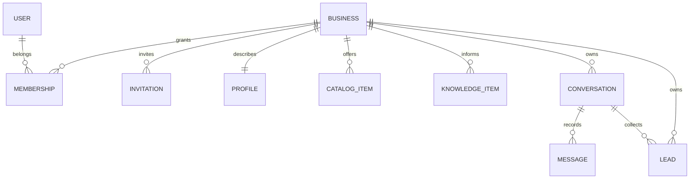
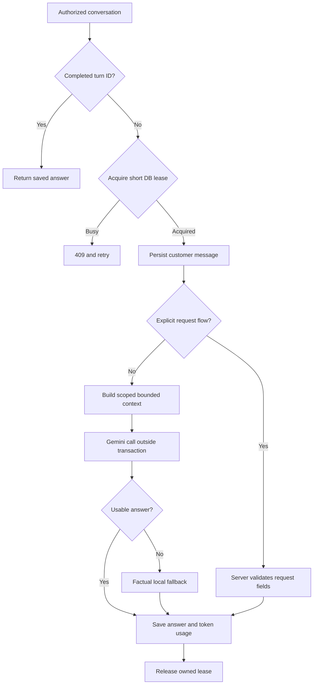

# Architecture audit

Scope: the provided NEXORA-WORK-FULL archive. No production database, deployment or provider key was included. The version names describe history, not separate verified code snapshots.

## Current boundaries

| Module | Responsibility | Data / important entry points | Assessment |
|---|---|---|---|
| core | Tenant membership, invitation onboarding, dashboards, connection links | Business, Membership, BusinessInvitation; launch_views, connect_views | Sensible MVP separation. Duplicate membership selectors consolidated. Business login was missing. |
| business_brain | Structured company facts | BusinessProfile, CatalogItem; forms, knowledge | Appropriate source of company prices and availability. Price/duration validation strengthened. |
| assistant_ai | Dialogue persistence, knowledge, Gemini, request collection | Conversation, Message, KnowledgeItem, Lead; universal_engine, lead_engine | Central engine is shared. Transport/context/state are now separate files. Request extraction still constrained. |
| public_chat | Anonymous customers | Session-bound conversation; chat_page/chat_send | Client cannot choose the tenant or conversation. No-store headers and bounded usage added. |
| business_center | Owner workspace / CRM | Knowledge editing, request search and status transitions | Search after slicing was broken. Confirmation logic unified. Not a complete CRM. |
| config | Environment, routing, middleware | settings, urls, test_runner | .env loading preserved; explicit production HTTPS mode and offline tests added. |

## Data model

Business foreign keys enforce ownership in application queries. They do not automatically create PostgreSQL row-level security. `Lead.business` duplicates `Conversation.business`; a model validation now rejects disagreement when `clean/full_clean` is used. Direct SQL and arbitrary ORM writes still bypass that validation; the server collection path sets the business from the conversation.

A platform operator's `User.is_staff` and a company `Membership.role='staff'` are different concepts. Ordinary owners do not get Django admin access. Platform administrators with model permissions intentionally have broader administrative access; this is not tenant-scoped business UI.

## Turn lifecycle after the update

`processing_token` and `processing_until` implement an expiring single-worker lease. The maximum Gemini timeout is shorter than the lease. A late worker cannot commit its answer or clear a newer lease. A timeout or crash leaves the customer's persisted message available for recovery. This is not a distributed job queue or exactly-once provider billing: a crashed worker can have incurred an API charge before a retry.

The frontend sends a UUID `turn_id`; a uniqueness constraint on conversation/role/turn prevents duplicate persisted replies. Completed replays reuse the saved answer. Public conversations have a unique business/session digest. Playground first turns have a unique business/customer/initial-turn identifier.

## Operations and scaling

SQLite is appropriate for local demonstration. Removing network calls from write transactions helps, but it does not make SQLite suitable for 100 busy companies. Quota rows and status transitions remain write contention points. Move to PostgreSQL with a tested migration, configure backup/restore, then benchmark real concurrent traffic. Add Redis/edge limits only when shared DB counters become a measured bottleneck.

The current engine uses synchronous Django workers. Each genuine Gemini call still occupies one worker up to its timeout. Streaming, task queues and WebSockets can improve experience later; they are not prerequisites for a measured small pilot.

The Sales Radar eagerly loads all conversations/messages: this remains a scalability cost. The conversation list now uses an annotated first-message subquery; a regression test checks that query count does not grow with dialogue count. Public history is now the newest 150 messages, while the stored history is kept. Public conversations are limited to 100 customer turns.

## Migration / portability

Original migrations declare BigAutoField primary keys; DEFAULT_AUTO_FIELD now matches them. The original catalog index name is explicit, avoiding a spurious index migration. Three additive assistant_ai migrations introduce leases, turn IDs, quota buckets and an atomic request-action receipt. No data rewrite or database file is shipped. Requirements are UTF-8 and now include the previously missing Gemini SDK and QR generator. Django 6.0.9 package metadata requires Python >=3.12; verification uses Python 3.13.16.

Full schema/data preservation checks are in TEST_RESULTS.md. Existing legacy public dialogues are recovered by their original session ownership; new ones use a digest constraint.

## Recovery hardening, 9 October

Message.request_response is a server-only receipt. A short transaction commits the Lead transition and this receipt together. If saving the final assistant Message fails, retrying the same turn returns the recorded request response without advancing collection. A processing-token fence prevents a stale worker from applying the action. Gemini requests in both channels share per-business and platform daily attempt budgets; completed replays and deterministic request collection incur no provider attempt. Attempts are not a money-denominated budget, and a provider-success/worker-crash can still be billed twice on retry.
